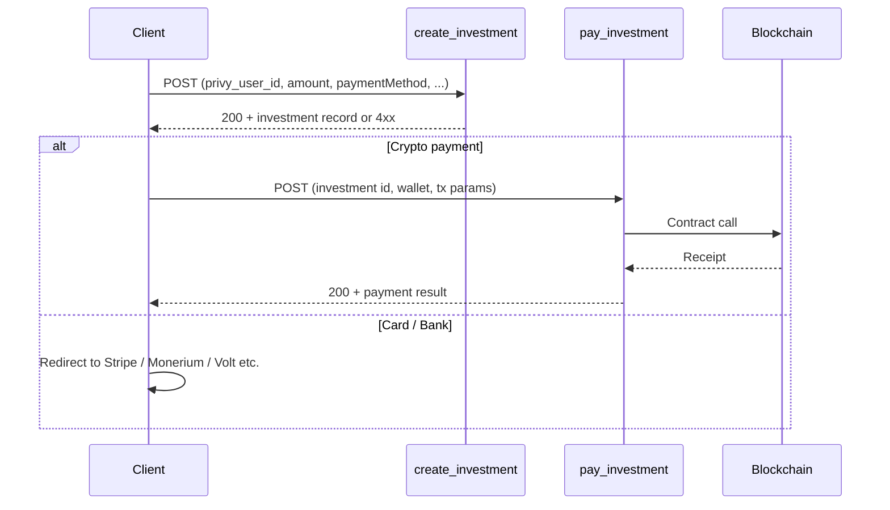
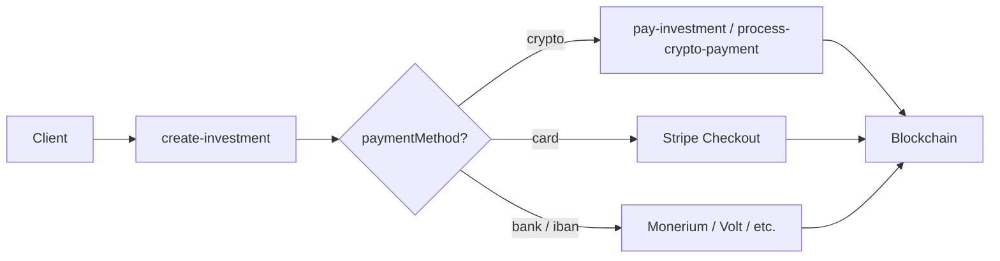
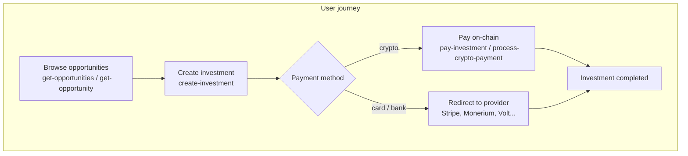
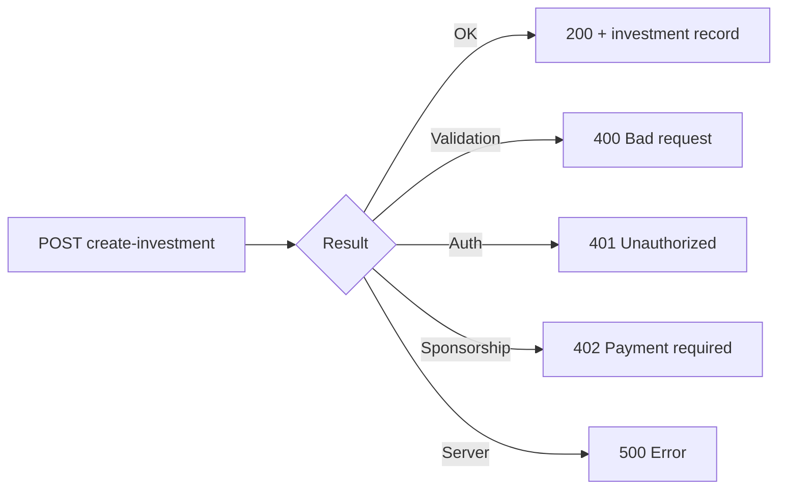

# Guides

This guide describes how investments work in Investhub: creating an investment, payment methods, and the main API flow.

> **Diagrams:** For Mermaid diagrams to render in GitBook, install the **Mermaid** integration in your space (Integrations → Mermaid), then add or edit diagrams using **Insert → Mermaid block** (type `/` and choose Mermaid) in the editor. Synced code blocks may show as code until re-added as native Mermaid blocks.

## Overview

Users invest in opportunities (e.g. tokenized offerings) by creating an investment record and then completing payment. Payment can be **crypto** (wallet), **card** (Stripe), **bank** (Volt, Monerium, etc.), or other configured methods.

## Create investment flow

1. **Client** calls `create-investment` with amount, token details, payment method, and (for crypto) network and wallet.
2. **Backend** validates the user (Privy JWT), opportunity, and spending caps; creates the investment record; and returns success or an error (e.g. 402 if sponsorship credits are required and insufficient).
3. For **crypto**: client may then call `pay-investment` or `process-crypto-payment` to execute the on-chain payment.
4. For **card/bank**: the client follows the returned payment link or session (e.g. Stripe Checkout, Monerium).

## Payment method flow (flowchart example)

Another way to visualize the flow is with a flowchart showing how the backend routes by payment method:

## Investment lifecycle (steps)

End-to-end steps from browsing to completed investment:

## create-investment response outcomes

Possible responses when calling `create-investment` (useful to see if this diagram renders from Git sync):

## Main endpoints

| Function                 | Purpose                                                                                                                                                                                                    |
| ------------------------ | ---------------------------------------------------------------------------------------------------------------------------------------------------------------------------------------------------------- |
| `create-investment`      | Create an investment (auth required). Body: `privy_user_id`, `opportunityId`, `amount`, `tokenAmount`, `tokenSymbol`, `tokenPrice`, `currency`, `paymentMethod`, `network`, optional `walletAddress`, etc. |
| `pay-investment`         | Complete payment for an existing investment (e.g. crypto).                                                                                                                                                 |
| `process-crypto-payment` | Process a crypto payment (e.g. MetaMask).                                                                                                                                                                  |
| `get-user-investments`   | List investments for the authenticated user.                                                                                                                                                               |
| `sponsored-transaction`  | Request a sponsored (gasless) transaction; returns **402** if sponsorship credits are insufficient.                                                                                                        |

## Screenshots

Below is an example of how a screenshot appears in the docs. Replace this with a real capture from the app (or use CI/Playwright to generate it).
