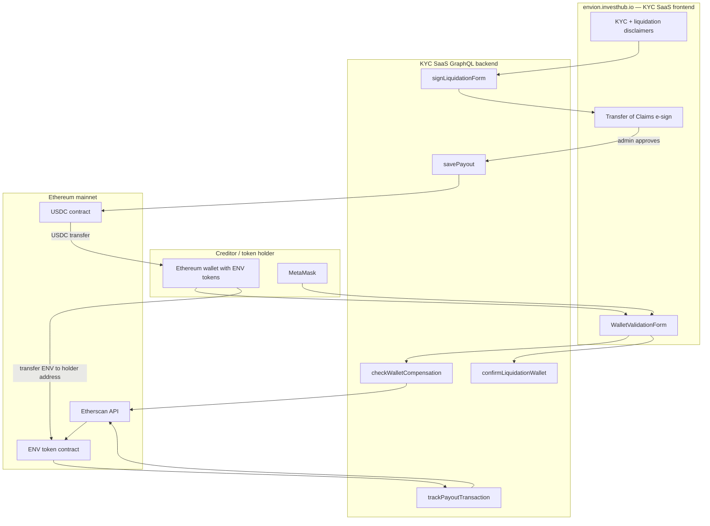

# Liquidation Management

This guide describes Investhub’s **liquidation management** product: a white-label workflow for bankruptcy and insolvency cases where token holders can verify their **USDC compensation quote**, complete KYC, **sign claim-transfer documents**, deposit tokens on-chain, and receive **USDC payouts**.

The production reference deployment is **[envion.investhub.io](https://envion.investhub.io/)** — built for **Envion AG in Liquidation** (EVN token holders in the Swiss bankruptcy process). Today this runs on the **legacy KYC SaaS stack** (separate repo under `reference-code/kyc-saas/`), not as an **investhubio UI tenant**. The platform goal is to host Envion and other issuers as **UI tenants** on one `investhubio` app under the same ECSP umbrella — see [`docs/planning/MULTI_TENANT_ARCHITECTURE.md`](https://github.com/Equanimity-Blockchain-Holdings-Pte-Ltd/investhubio/blob/main/docs/planning/MULTI_TENANT_ARCHITECTURE.md).

> **Demo:** See the [Envion liquidation walkthrough on YouTube](https://www.youtube.com/watch?v=IEq1fkCRRcA&t=62s).

---

## Overview

| Step | What the user does | What the platform does |
|------|-------------------|------------------------|
| 1. Quote | Enters Ethereum wallet address | Reads on-chain ENV transfers via Etherscan; calculates USDC compensation |
| 2. Wallet proof | Signs a MetaMask message | Confirms wallet ownership; locks receiving address |
| 3. KYC | Completes identity verification | Liquidation-specific disclaimers and creditor onboarding |
| 4. Sign | E-signs Transfer of Claims PDFs | SignNow / Skribble; multi-party signature workflow |
| 5. Deposit | Sends ENV tokens to platform holder address | Tracks inbound transfers as `CompensationTracking` records |
| 6. Payout | Waits for compliance approval | Admin sends **USDC** on Ethereum; tx hash recorded and linked to signed documents |

**Payout currency:** USDC on Ethereum mainnet (`0xA0b86991c6218b36c1d19D4a2e9Eb0cE3606eB48`, 6 decimals).

**Source token (Envion):** EVN/ENVION ERC-20 on Ethereum (`0xd780ae2bf04cd96e577d3d014762f831d97129d0`).

---

## Where the code lives

Liquidation is implemented in the **KYC SaaS stack** (GraphQL backend + React frontend), not in the main Supabase Edge Function app. In the GitHub repo:

| Layer | Path |
|-------|------|
| **Backend GraphQL API** | `reference-code/kyc-saas/kyc-saas-backend/` |
| **Liquidation resolvers** | `…/src/resolvers/liquidation.js` |
| **Liquidation service (rates, amounts)** | `…/src/service/liquidationService.js` |
| **Etherscan token history** | `…/src/service/etherscanService.js` |
| **PDF + e-sign (Transfer of Claims)** | `…/src/service/pdfService.js`, `…/src/service/signnowService.js`, `…/src/service/skribbleService.js` |
| **GraphQL schema** | `…/src/typeDefs/liquidation.js` |
| **USDC contract config** | `…/src/config/liquidation.js` |
| **Frontend** | `reference-code/kyc-saas/kyc-saas-frontend/` |
| **Quote + wallet UI** | `…/src/components/WalletValidationForm.jsx` |
| **Admin USDC payout button** | `…/src/components/SendCompensationButton.jsx` |
| **Admin compensatable table** | `…/src/components/AdminCompensatableTable.jsx` |
| **Routes (`/transfer-claim`, wallet validate)** | `…/src/routes.jsx`, `…/src/pages/WalletValidate.jsx` |

The **main Investhub app** (`src/`, Supabase) references Envion in token metadata and supports off-chain liquidation valuations in the portfolio cache, but the full liquidation **quote → sign → USDC** pipeline still runs on the **legacy KYC SaaS** deployment at `envion.investhub.io` until ported to a **UI tenant** on `investhubio`.

Token metadata in the main app: `src/constants/tokenData.ts` (Envion AG, Liquidation Payout 1#/2# children).

---

## Architecture



---

## Compensation quote

### How the quote is calculated

When a user clicks **Check compensation**, the backend runs `checkWalletCompensation`:

1. Load tenant settings: `liquidation_contract_address`, `liquidation_token_decimal`, `liquidation_holder_addresses`.
2. Call Etherscan `tokentx` for the wallet and ENV contract.
3. Filter transfers **from** the user’s wallet **to** configured holder addresses.
4. Sum token amounts (adjusted for decimals).
5. Multiply by the **compensation rate** from `liquidationService.getCompensationRate()`.

```
compensation_usdc = total_env_tokens × compensation_rate
```

**Default rate:** `0.081` USDC per ENV token (overridable per tenant via `liquidation_compensation_rate`).

**Per-wallet overrides:** `liquidation_specific_compensation_rate` — newline-separated `address,rate` pairs.

**Code:** `reference-code/kyc-saas/kyc-saas-backend/src/resolvers/liquidation.js` (`checkWalletCompensation`), `liquidationService.js`.

### GraphQL

```graphql
query checkWalletCompensation($walletAddress: String!) {
  checkWalletCompensation(walletAddress: $walletAddress)
}
```

**Response shape:**

```json
{
  "token": 12345.67,
  "compensation": 1000.00
}
```

(`compensation` is in USDC.)

---

## Wallet validation and ownership proof

After a positive quote, the user clicks **Use this wallet**:

1. MetaMask connects and signs: *"Please sign this message to confirm the ownership of provided wallet"*.
2. Backend verifies signer address matches the entered wallet.
3. `confirmLiquidationWallet` checks the wallet still holds ENV tokens (via Etherscan).
4. User record updated: `is_valid_liquidation_wallet: true`, `wallet_address` set, wallet change disabled.

User is then redirected to `/application` for KYC.

**Frontend:** `WalletValidationForm.jsx`  
**Backend:** `confirmLiquidationWallet` in `liquidation.js`

---

## KYC and Transfer of Claims signing

For tenants with `token_type = LIQUIDATION`, the KYC flow includes liquidation-specific disclaimers (claim transfer, consent, GDPR).

When a **creditor number** is assigned (`updateCreditorNumber`), the platform generates a **Transfer of Claims** PDF bundle and sends it for e-signature via **SignNow** (and optionally **Skribble**):

| Template flag | Document section |
|---------------|------------------|
| `trado` | Trado / GDPR addendum |
| `envion` | Envion claim transfer (2 pages) |
| `gtcm` | GTCM (non-German) |
| `amb` | AMB (German) |
| `contract` | Contract when no legal protection insurance |

PDF assembly: `pdfService.createSignnowEnvionFormData()` — merges templates from `pdfs/liquidationForm/`.

E-sign workflow: `signnowService.signLiquidationForm()` — two signers:

1. **Signer 1:** Creditor (customer email)
2. **Signer 2:** Compliance / payout approver (tenant `mailgun.from_kyc_approval_email`)

Signature requirements before payout:

- Payout **≥ 5,000 USDC:** full document must be `fulfilled` (both signers).
- Payout **< 5,000 USDC:** creditor signature alone is sufficient.

**Code:** `customerIndividual.js` (`updateCreditorNumber`), `signnowService.js` (`signLiquidationForm`, `createEnvionDocument`).

---

## Token deposit and tracking

After KYC approval, the creditor sends ENV tokens from their wallet to a **platform holder address** (configured in tenant settings).

Each inbound transfer is recorded in **`CompensationTracking`**:

| Field | Meaning |
|-------|---------|
| `transactionHash` | On-chain ENV transfer tx |
| `amount` | Raw token amount (wei-style) |
| `decimal` | Token decimals |
| `compensationRateAtConfirmation` | Rate locked at tracking time |
| `status` | `NOT_PAID` → `PENDING` → `PAID` |
| `transferedAt` | Block timestamp |

Tracking is refreshed via `trackPayoutTransaction()` when KYC status changes — it re-scans Etherscan for new transfers to holder addresses.

---

## USDC payout

### Admin flow

Compliance officers use **AdminCompensatableTable** + **SendCompensationButton**:

1. Review `getUserCompensationTracking` — list of ENV deposits and total USDC due.
2. Confirm `checkLiquidationDocumentHasNeededSignatures` is satisfied.
3. Connect MetaMask wallet funded with USDC.
4. Click **Send compensation** — calls USDC `transfer(recipient, amount)` on Ethereum.
5. On tx success, call `savePayout` with `payoutTxHash` and tracking IDs.

Backend waits for on-chain confirmation, parses USDC amount from tx input, creates `CompensationPayout`, marks tracking rows `PAID`, and prefills the SignNow document with `transaction_hash`.

**USDC transfer (frontend):** `SendCompensationButton.jsx` — encodes `contract.methods.transfer(addressTo, amount * 10^6)`.

**Payout recording (backend):** `savePayout` / `savePayoutForKyc` in `liquidation.js`.

### GraphQL mutations

```graphql
mutation confirmLiquidationWallet($walletAddress: String!) {
  confirmLiquidationWallet(walletAddress: $walletAddress)
}

mutation savePayout($payoutTxHash: String!, $transactionIds: [ID]!, $userId: ID!) {
  savePayout(payoutTxHash: $payoutTxHash, transactionIds: $transactionIds, userId: $userId)
}
```

---

## End-to-end sequence

```mermaid
sequenceDiagram
  participant User
  participant UI as envion.investhub.io
  participant API as KYC GraphQL API
  participant ES as Etherscan
  participant Sign as SignNow
  participant Admin
  participant USDC as USDC contract

  User->>UI: Enter wallet, Check compensation
  UI->>API: checkWalletCompensation(wallet)
  API->>ES: tokentx (ENV contract, wallet → holders)
  ES-->>API: transfer list
  API-->>UI: { token, compensation USDC }

  User->>UI: Sign MetaMask message, Use this wallet
  UI->>API: confirmLiquidationWallet
  API-->>UI: OK → redirect to KYC

  User->>UI: Complete KYC + disclaimers
  Admin->>API: updateCreditorNumber
  API->>Sign: Transfer of Claims PDF invite
  User->>Sign: E-sign as creditor
  Admin->>Sign: E-sign as approver

  User->>User: Send ENV tokens to holder address
  API->>ES: trackPayoutTransaction
  ES-->>API: CompensationTracking NOT_PAID

  Admin->>UI: Send compensation (USDC)
  UI->>USDC: transfer(userWallet, amount)
  USDC-->>UI: txHash
  UI->>API: savePayout(txHash, trackingIds)
  API-->>User: USDC received; status PAID
```

---

## Tenant configuration

Each liquidation tenant (e.g. `envion.investhub.io`) stores these settings:

| Setting | Purpose |
|---------|---------|
| `token_type` | Must be `LIQUIDATION` |
| `liquidation_contract_address` | Source token contract (ENV for Envion) |
| `liquidation_token_decimal` | Token decimals for amount math |
| `liquidation_holder_addresses` | Newline-separated addresses that accept ENV deposits |
| `liquidation_compensation_rate` | Default USDC-per-token rate (e.g. `0.081`) |
| `liquidation_specific_compensation_rate` | Optional per-wallet overrides: `0xabc...,0.09` |
| SignNow credentials | E-sign for Transfer of Claims |

**DNS:** `envion.investhub.io` → CNAME → `app.investhub.io` (tenant resolved at runtime by hostname).

**Code reference:** `reference-code/investhub-gitlab/backend/src/resolvers/tenant.js` (allowed hosts include `envion.investhub.io`).

---

## User-facing routes (KYC SaaS frontend)

| Route | Purpose |
|-------|---------|
| `/` | Dashboard; liquidation tenants link to `/transfer-claim` |
| `/transfer-claim` | Main claim transfer entry (Envion-specific UI) |
| `/transfer-claim/guide` | Step-by-step guide |
| `/transfer-claim/claim-with-liquidator` | Claim via liquidator path |
| `/transfer-claim/claim-with-credit-card` | Alternative claim path |
| `/transfer-claim/claim-with-bitcoin` | Alternative claim path |
| Wallet validate page | Quote calculator + MetaMask confirmation → `/application` |

> **Note:** `TransferClaim` page components are referenced in `routes.jsx` but may not be present in all repo snapshots; the core quote/sign/payout logic is in the components listed above.

---

## Relation to main Investhub platform

| Feature | KYC SaaS (liquidation) | Main app (investhub.io) |
|---------|------------------------|-------------------------|
| Quote from wallet | ✅ `checkWalletCompensation` | — |
| KYC + e-sign | ✅ SignNow / Skribble | SumSub KYC |
| USDC payout on-chain | ✅ `SendCompensationButton` | Crypto payments via crowdsale contracts |
| Portfolio valuation | — | `get-portfolio-cached` supports `manual_valuation` for off-chain liquidation values |
| Shareholder broadcasts | — | `xmtp-broadcast` supports message type `liquidation` |
| Token explorer metadata | — | `tokenData.ts` — Envion, Liquidation Payout 1#/2# |

---

## Related GraphQL API (compliance / admin)

| Query / mutation | Role | Min rights |
|------------------|------|------------|
| `getUserCompensationTracking` | List ENV deposits + totals | COMPLIANCE_OFFICER |
| `getUserCompensationPayout` | Payout history | COMPLIANCE_OFFICER |
| `checkLiquidationDocumentHasNeededSignatures` | Sign-off gate | COMPLIANCE_OFFICER |
| `checkBatchCompensate` | Batch payout eligibility | COMPLIANCE_OFFICER |
| `getUserCompensationRate` | Current rate for logged-in user | Auth |
| `addLiquidationProof` | Upload tx hashes or files (lawyer transfer path) | Auth |
| `savePayoutForKyc` | Record payout by KYC id | COMPLIANCE_OFFICER |

Full schema: `reference-code/kyc-saas/kyc-saas-backend/src/typeDefs/liquidation.js`.

---

## Reusing for other liquidations

The same pattern applies to any tokenized bankruptcy:

1. Create a white-label tenant (`*.investhub.io` or custom domain).
2. Set `token_type = LIQUIDATION` and liquidation_* settings.
3. Configure holder addresses and compensation rate(s).
4. Customize PDF templates in `pdfs/liquidationForm/`.
5. Fund an admin USDC wallet for payouts.

This is the infrastructure referenced in the ECSP strategy as prior art: **automated creditor onboarding, signed claim transfer, on-chain token receipt, and USDC distribution** — proven at scale with Envion (~6,000 creditors in related materials).

---

## Further reading

- [Investments guide](investments.md) — main platform subscription flow
- [White-Label Tenants](white-label.md) — tenant provisioning on Investhub
- [Envion bankruptcy portal](https://www.envion-konkurs.ch/) — official creditor information
- Envion token on Etherscan: [0xd780ae2bf04cd96e577d3d014762f831d97129d0](https://etherscan.io/token/0xd780ae2bf04cd96e577d3d014762f831d97129d0)
