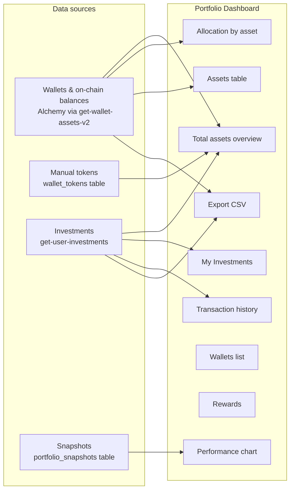
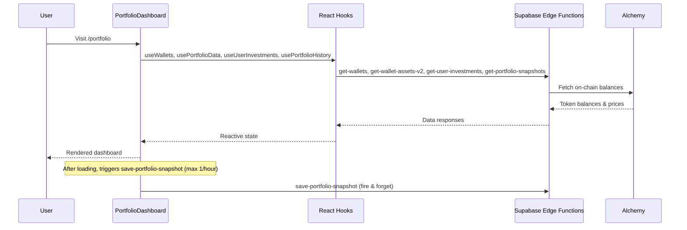

# Portfolio Dashboard

This guide covers the portfolio dashboard, its sections, data sources, and features such as the net worth overview, allocation chart, transaction history, and CSV export.

## Overview

The portfolio dashboard (`/portfolio`) gives users a consolidated view of their net worth across on-chain wallets, manual tokens, and investment commitments. It is available to users with the `personal` or `administrator` role.

## Dashboard sections

### Total assets overview

Displays the aggregate portfolio value with profit/loss when entry prices are available.

| Element | Description |
|---------|-------------|
| **Total assets** | Sum of on-chain wallet balances + manual tokens. An info tooltip explains what is included. |
| **P&L** | `Total value - Total invested`. Requires entry prices (set via the "Manage Tokens" dialog). |
| **Breakdown** | Shows "On-chain & tokens: $X" and "Committed to opportunities: $Y" separately. |
| **Compact trend** | A small sparkline (1-month history) rendered inline from `portfolio_snapshots`. |

**Key files:** `src/components/portfolio/PortfolioOverview.tsx`, `src/hooks/usePortfolioHistory.ts`

### Allocation by asset

A horizontal bar chart showing the top 6 assets by USD value. Computed client-side from current wallet balances — no additional API call.

**Key file:** `src/components/portfolio/PortfolioOverview.tsx`

### Performance chart

A larger area chart with selectable time ranges (1M, 6M, 12M, 24M). Data comes from `portfolio_snapshots` via the `get-portfolio-snapshots` edge function.

Portfolio snapshots are saved automatically (at most once per hour) when the user visits the dashboard. The `save-portfolio-snapshot` edge function aggregates all wallet balances for the user and inserts a row into `portfolio_snapshots`.

**Key files:** `src/components/portfolio/PortfolioChart.tsx`, `src/hooks/usePortfolioHistory.ts`

### My Investments

Lists all investments the user has made through InvestHub opportunities. Each card shows: opportunity name, amount, currency, status badge, token/network info, payment method, and a link to the opportunity or block explorer (if a `tx_hash` exists).

**Key file:** `src/components/portfolio/MyInvestments.tsx`

### Transaction history

A chronological ledger of investment events (created, paid, refunded). Sorted newest-first and capped at 10 entries by default. Each row includes: date, opportunity name, amount, status, and an explorer/opportunity link.

This section reuses the same `get-user-investments` data — no additional backend endpoint is required.

**Key file:** `src/components/portfolio/TransactionHistory.tsx`

### Assets table

Shows all detected on-chain assets aggregated by symbol. Includes balance, price, value, allocation %, and chain badges. Two view modes:

- **Combined view** (`AssetsTable`) — all assets in one table, grouped by symbol.
- **Per-wallet view** (`WalletAssetsView`) — assets grouped by wallet address.

**Key files:** `src/components/portfolio/AssetsTable.tsx`, `src/components/portfolio/WalletAssetsView.tsx`

### Wallets list

Lists all tracked wallets (address, source label). Users can add wallets via the "Add Wallet" dialog.

**Key file:** `src/components/portfolio/WalletsList.tsx`

### Rewards

Rewards functionality is planned but not yet available. The section displays a "Coming soon" state with an icon and short description.

**Key file:** `src/components/portfolio/RewardsSection.tsx`

## Export CSV

Users can export their portfolio and investment data as a CSV file by clicking the **Export CSV** button in the dashboard header.

The CSV contains three sections:

1. **Summary** — export date, total value, total invested.
2. **Assets** — symbol, name, balance, price, value, chain, wallet address.
3. **Investments** — date, opportunity name, amount, currency, status, network.

Export is performed entirely client-side (no backend endpoint); the browser generates the file from the current dashboard state.

**Key files:** `src/utils/exportPortfolioCsv.ts`, `src/pages/PortfolioDashboard.tsx`

## Data flow

## Caching

The dashboard uses two layers of caching for instant display:

| Layer | Mechanism | TTL |
|-------|-----------|-----|
| **Local storage cache** | `usePortfolioCache` stores summary values (total, counts) in `localStorage`. On next visit the cached data renders immediately while fresh data loads. | Until overwritten by fresh data |
| **React Query** | `useWalletAssets`, `usePortfolioData`, and `usePortfolioHistory` use `staleTime` of 5-10 minutes. No auto-refetch on window focus. | 5-10 minutes |

## View modes

The `ViewModeToggle` lets users switch between:

- **All wallets** — aggregated view across every tracked wallet.
- **Single wallet** — filters assets and value to one specific wallet.

## Related API endpoints

| Endpoint | Purpose |
|----------|---------|
| `get-wallets` | List tracked wallets for the user |
| `get-wallet-assets-v2` | Fetch on-chain balances for a wallet (Alchemy) |
| `get-user-investments` | List all investment records |
| `get-portfolio-cached` | Return cached portfolio summary |
| `get-portfolio-snapshots` | Historical snapshots for charting |
| `save-portfolio-snapshot` | Save a new snapshot (triggered on visit) |

For details on each endpoint, see the [API Reference](/api/).

## Testing

Below is a manual checklist to verify each dashboard feature.

### Total assets overview

1. Log in and navigate to `/portfolio`.
2. Verify the "Total assets" headline is visible with an info (i) icon. Hover over the icon to see the tooltip.
3. If entry prices have been set for any token, confirm P&L appears with a green or red arrow and percentage.
4. If the user has investments, confirm the breakdown line shows both "On-chain & tokens" and "Committed to opportunities" values.
5. With no wallets and no investments, verify the value reads `$0.00` and no breakdown or P&L appears.

### Allocation by asset

1. Add at least two wallets with different token holdings.
2. Confirm the "Allocation by asset" bar chart appears below the total value, showing up to 6 assets sorted by value.
3. Each bar should have a symbol label (left), proportional bar, and USD amount (right).
4. With zero assets, confirm the section is hidden entirely (no empty chart).

### Compact trend sparkline

1. Ensure the user has at least 2 data points in `portfolio_snapshots` (visit the dashboard on two different days, or insert test rows directly in Supabase).
2. Confirm a small sparkline appears under the total assets value.
3. With fewer than 2 snapshots, confirm the sparkline is hidden.

### Performance chart

1. With snapshot data, select each time range (1M, 6M, 12M, 24M) and verify the area chart updates.
2. With no data, confirm the "No historical data available yet" empty state appears.
3. On mobile, verify the time range selector is a dropdown rather than buttons.

### Transaction history

1. Create one or more investments via `/instant-investment` or an opportunity page.
2. Navigate to `/portfolio` and scroll to "Transaction history".
3. Verify entries are sorted newest-first, showing date, opportunity name, amount, status badge, and explorer link (when `tx_hash` is present).
4. Click an explorer link and confirm it opens the correct block explorer for the network (Base, Polygon, Ethereum, etc.).
5. With zero investments, confirm the empty-state message "No transactions yet" appears.

### Export CSV

1. With assets and/or investments loaded, click **Export CSV** in the header.
2. Verify a file named `portfolio-export-YYYY-MM-DD.csv` downloads.
3. Open the CSV and confirm three sections: Summary (total value, total invested), Assets (symbol, name, balance, price, value, chain, wallet), and Investments (date, opportunity, amount, currency, status, network).
4. Verify values with commas or quotes are properly escaped.
5. With no data, confirm the CSV still downloads with headers but empty data rows.

### Rewards section

1. Navigate to `/portfolio` and scroll to the right column.
2. Confirm the Rewards card shows a sparkles icon, "Coming soon" heading, and a short description.
3. Verify there are no mock data items, claim buttons, or "total earned" amounts.

### View mode toggle

1. Add two or more wallets.
2. Use the view mode toggle to switch between "All wallets" and a specific wallet address.
3. Confirm the assets table, overview values, and allocation chart update to reflect only the selected wallet.
4. Switch back to "All wallets" and confirm the aggregated view returns.

### Refresh

1. Click the **Refresh** button in the header.
2. Confirm the spinner icon animates while data reloads.
3. In the browser network tab, verify new calls to `get-wallet-assets-v2` and `get-user-investments`.

### Skeleton loading states

1. Clear the portfolio cache from `localStorage` (DevTools > Application > Local Storage > remove `portfolio_cache` key).
2. Hard-reload `/portfolio`.
3. Confirm skeleton placeholders appear for the overview, investments, assets, and rewards sections until data loads.
