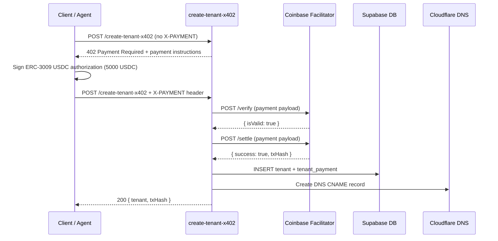
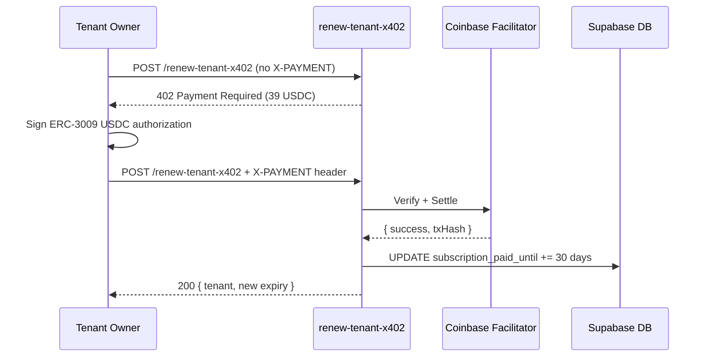

# White-Label UI Tenants

This guide covers **UI tenants** — branded investor-facing hostnames on the **single** `investhubio` deployment. Operators (issuers, Dagobert, liquidation cases) get their own subdomain, logo, and deal filter while sharing the same app, KYC, and compliance stack under the ECSP umbrella.

> **Terminology:** A **UI tenant** is **not** the legacy **KYC SaaS tenant** (separate GraphQL stack per issuer, e.g. old Envion liquidation). See [`docs/planning/MULTI_TENANT_ARCHITECTURE.md`](https://github.com/Equanimity-Blockchain-Holdings-Pte-Ltd/investhubio/blob/main/docs/planning/MULTI_TENANT_ARCHITECTURE.md).

> **x402 Protocol:** The tenant provisioning API uses the [x402 protocol](https://www.x402.org/) for payment. On first call, the API returns HTTP 402 with USDC payment instructions. The client signs an ERC-3009 `transferWithAuthorization`, then retries with the signed payload in the `X-PAYMENT` header. Payment is verified and settled on-chain via the Coinbase facilitator before the tenant is created.

## Overview

A **UI tenant** is a branded hostname (e.g. `envion.investhub.io`, `dagobert.investhub.org`) served from **one** React + Supabase deployment. `TenantContext` resolves config at runtime from the request hostname. Each issuer UI can show a different subset of deals via `allowedTokenIds`; KYC and invest flows are **platform-wide**, not per-repo.

Each tenant can configure:

| Setting | Description |
|---------|-------------|
| `appName` | Display name shown in browser title and UI |
| `logoUrl` | Primary logo (light mode) |
| `logoDarkUrl` | Logo for dark mode |
| `faviconUrl` | Browser favicon |
| `primaryColor` | HSL primary color (e.g. `210 100% 50%`) |
| `accentColor` | HSL accent color |
| `allowedTokenIds` | Array of token IDs visible to this tenant's users |
| `hiddenRoutes` | Array of URL paths to hide from navigation |
| `privyAppId` | Optional tenant-specific Privy application ID |

## Pricing

| Fee | Amount | When |
|-----|--------|------|
| Setup | 5,000 USDC | One-time, paid via x402 on Base |
| Monthly renewal | 39 USDC | Push model — owner pays each month via x402 on Base |

If a tenant's subscription expires and is not renewed, the tenant is automatically suspended (`STOPPED`) by a cron job. Suspended tenants lose their custom branding and fall back to the default InvestHub experience.

## Setup flow



## Renewal flow



## API Reference

All endpoints use **Privy JWT** authentication. Include `Authorization: Bearer <privy_access_token>` in every request.

### POST `/functions/v1/create-tenant-x402`

Create a new white-label tenant. Payment-gated at 5,000 USDC on Base.

**Request body:**

```json
{
  "subdomainType": "investhubSubdomain",
  "customDomain": "buyersclub",
  "appName": "BuyersClub",
  "logoUrl": "https://example.com/logo.png",
  "logoDarkUrl": "https://example.com/logo-dark.png",
  "primaryColor": "210 100% 50%",
  "accentColor": "160 80% 45%",
  "allowedTokenIds": [1, 3, 7],
  "hiddenRoutes": ["/incorporate", "/manage"]
}
```

| Field | Type | Required | Description |
|-------|------|----------|-------------|
| `subdomainType` | `"investhubSubdomain"` \| `"ownSubdomain"` | Yes | Use `investhubSubdomain` for `*.investhub.io` (DNS auto-configured) or `ownSubdomain` for a custom domain (manual DNS) |
| `customDomain` | string | Yes | Subdomain name (e.g. `buyersclub`) or full domain (e.g. `app.buyersclub.com`) |
| `appName` | string | No | Display name |
| `logoUrl` | string | No | Logo URL (light mode) |
| `logoDarkUrl` | string | No | Logo URL (dark mode) |
| `primaryColor` | string | No | HSL color string |
| `accentColor` | string | No | HSL color string |
| `allowedTokenIds` | number[] | No | Token IDs to show (null = show all) |
| `hiddenRoutes` | string[] | No | Routes to hide from navigation |

**Responses:**

- **402** (no `X-PAYMENT` header): Returns payment instructions.

```json
{
  "x402Version": 1,
  "accepts": [{
    "scheme": "exact",
    "network": "eip155:8453",
    "maxAmountRequired": "5000000000",
    "resource": "https://<supabase>/functions/v1/create-tenant-x402",
    "description": "White-label tenant setup fee ($5,000 USDC on Base)",
    "mimeType": "application/json",
    "payTo": "0xC122a2F4BA78B9A890E59abEF99ec992A2C5b06a",
    "maxTimeoutSeconds": 300,
    "asset": "0x833589fCD6eDb6E08f4c7C32D4f71b54bdA02913"
  }]
}
```

- **200** (with valid `X-PAYMENT` header): Tenant created.

```json
{
  "success": true,
  "tenant": {
    "id": "uuid",
    "host": "buyersclub.investhub.io",
    "status": "RUNNING",
    "subdomain_type": "investhubSubdomain",
    "subscription_paid_until": "2026-04-08T14:00:00.000Z"
  },
  "payment": {
    "txHash": "0x...",
    "amount": "$5,000 USDC",
    "chain": "Base"
  }
}
```

### POST `/functions/v1/renew-tenant-x402`

Renew the subscription for an existing tenant. Payment-gated at 39 USDC on Base.

**Request body:** None required (tenant is resolved from the authenticated user's profile).

**Responses:**

- **402** (no `X-PAYMENT` header): Returns payment instructions for 39 USDC.
- **200** (with valid `X-PAYMENT` header): Subscription extended by 30 days.

```json
{
  "success": true,
  "tenant": {
    "id": "uuid",
    "host": "buyersclub.investhub.io",
    "status": "RUNNING",
    "subscription_paid_until": "2026-05-08T14:00:00.000Z"
  },
  "payment": {
    "txHash": "0x...",
    "amount": "$39 USDC",
    "chain": "Base"
  }
}
```

### GET `/functions/v1/get-tenant-config`

Public endpoint. Returns branding configuration for the tenant matching the `Origin` header's hostname. No authentication required.

**Response:**

```json
{
  "appName": "BuyersClub",
  "logoUrl": "https://example.com/logo.png",
  "logoDarkUrl": "https://example.com/logo-dark.png",
  "faviconUrl": null,
  "primaryColor": "210 100% 50%",
  "accentColor": "160 80% 45%",
  "allowedTokenIds": [1, 3, 7],
  "hiddenRoutes": ["/incorporate", "/manage"],
  "privyAppId": null
}
```

### POST `/functions/v1/check-tenant-subscriptions`

Internal/cron endpoint. Suspends all tenants whose `subscription_paid_until` has passed. No authentication required (intended for cron/scheduler invocation).

**Response:**

```json
{
  "suspended": 2,
  "tenants": [
    { "id": "uuid", "host": "expired.investhub.io", "expired_at": "2026-03-01T00:00:00Z" }
  ],
  "message": "Suspended 2 expired tenant(s)"
}
```

## Agent integration example

An AI agent or script can provision a tenant programmatically using the [x402 fetch wrapper](https://www.npmjs.com/package/@x402/fetch):

```typescript
import { wrapFetch } from '@x402/fetch';

const x402Fetch = wrapFetch(fetch, {
  privateKey: process.env.WALLET_PRIVATE_KEY,
});

const response = await x402Fetch(
  'https://<supabase>/functions/v1/create-tenant-x402',
  {
    method: 'POST',
    headers: {
      'Authorization': `Bearer ${privyAccessToken}`,
      'Content-Type': 'application/json',
    },
    body: JSON.stringify({
      subdomainType: 'investhubSubdomain',
      customDomain: 'myoperator',
      appName: 'My Operator',
      logoUrl: 'https://example.com/logo.png',
      primaryColor: '220 90% 56%',
      allowedTokenIds: [1, 2],
    }),
  },
);

const result = await response.json();
console.log('Tenant created:', result.tenant);
console.log('Payment tx:', result.payment.txHash);
```

The `@x402/fetch` wrapper automatically:

1. Detects the 402 response
2. Signs an ERC-3009 `transferWithAuthorization` for the required USDC amount
3. Retries the request with the `X-PAYMENT` header

## Manual testing with curl

You can also test the x402 flow manually in two steps:

**Step 1 — Get payment instructions:**

```bash
curl -X POST https://<supabase>/functions/v1/create-tenant-x402 \
  -H "Authorization: Bearer <privy_token>" \
  -H "Content-Type: application/json" \
  -d '{"subdomainType":"investhubSubdomain","customDomain":"testdomain"}'
```

This returns HTTP 402 with the payment requirements JSON.

**Step 2 — Pay and create:**

After signing the ERC-3009 authorization off-chain, retry with the payment payload:

```bash
curl -X POST https://<supabase>/functions/v1/create-tenant-x402 \
  -H "Authorization: Bearer <privy_token>" \
  -H "Content-Type: application/json" \
  -H "X-PAYMENT: <signed_payment_payload>" \
  -d '{"subdomainType":"investhubSubdomain","customDomain":"testdomain","appName":"Test"}'
```

## Database schema

### `tenants` table (relevant columns)

| Column | Type | Description |
|--------|------|-------------|
| `subscription_paid_until` | timestamptz | When the paid period expires |
| `app_name` | text | Display name |
| `logo_url` | text | Logo (light mode) |
| `logo_dark_url` | text | Logo (dark mode) |
| `favicon_url` | text | Favicon URL |
| `primary_color` | text | HSL primary color |
| `accent_color` | text | HSL accent color |
| `allowed_token_ids` | integer[] | Token IDs visible to tenant users |
| `hidden_routes` | text[] | Routes hidden from navigation |
| `privy_app_id` | text | Tenant-specific Privy app ID |

### `tenant_payments` table

| Column | Type | Description |
|--------|------|-------------|
| `id` | uuid | Primary key |
| `tenant_id` | uuid | FK to tenants |
| `user_id` | uuid | FK to profiles |
| `payment_type` | text | `setup` or `recurring` |
| `amount_usdc` | numeric(18,6) | Payment amount |
| `tx_hash` | text | On-chain transaction hash (unique) |
| `chain` | text | Blockchain (default: `base`) |
| `network_id` | text | EIP-155 network ID (default: `eip155:8453`) |
| `status` | text | `pending`, `confirmed`, or `failed` |
| `period_start` | timestamptz | Subscription period start |
| `period_end` | timestamptz | Subscription period end |
